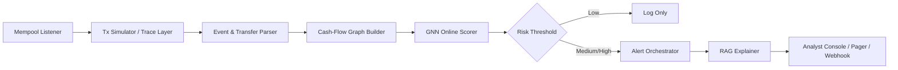
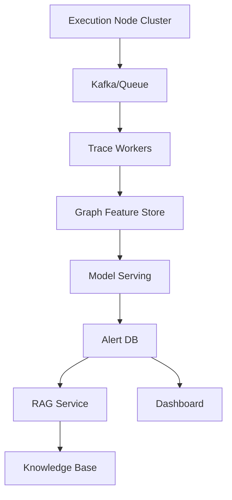

# Real-time DeFi Price Manipulation Alert System 项目计划报告

## 执行摘要

本项目适合做成“**实时风险评分 + 证据化解释 + 分级处置**”三段式系统：热路径只负责在 pending 阶段尽快发现高风险交易，冷路径再补齐历史上下文、相似案例与审计/协议证据，避免把系统做成“每笔交易都先写一篇论文”，结果论文还没写完，钱先没了。以太坊当前以 12 秒 slot 为节奏；你上传的 fileciteturn0file0 和同题论文显示，基于 cash-flow graph 的 GNN 检测在 208/2080 数据集上可达到 93.25% Accuracy、96.18% AUC，端到端分类耗时 0.892–5.317 秒，说明“**在出块前发出预警**”是现实可行的。citeturn12view0turn12view1turn14view2turn14view3

若链范围、预算、LLM、向量库均**未指定**，建议一期只做 **Ethereum 主网**，采用“**本地执行节点为主，第三方 RPC 为备；GraphSAGE 在线主模型，Temporal/Transformer 只做二级复核；RAG 异步解释，不阻塞告警**”的策略。规则系统方面，urlDeFiRangerturn5search3 曾在 3.5 亿笔交易中检出 432 起真实攻击，证明规则/语义基线仍有价值；但其模式维护成本较高，正好适合作为你系统的对照组，而不是最终形态。citeturn14view1turn14view2

## 项目目标、交付物与关键决策

**短期目标**：打通 mempool 监听、trace 模拟、cash-flow graph 构建、GraphSAGE 推理与告警投递；交付 PoC、离线回测报告、样例告警页面。**中期目标**：加入地址标签、协议文档、审计报告与 exploit postmortem 的 RAG 解释；交付在线 dashboard、证据模板、人工复核流程。**长期目标**：扩展到多协议、多链与自动化应急建议，形成可持续的安全运营系统。建议 KPI：离线 AUC ≥0.95、Recall@FPR≤3% ≥0.80；在线 P95 检测延迟 <3 秒、P99 <8 秒；解释模块覆盖率 100%，所有高危告警都附带图证据与文本证据。以上阈值以 12 秒 slot 和 DeFiGuard 的经验时延为锚，属于**项目目标**而非既成事实。citeturn12view1turn14view2turn14view3

**关键假设与风险**：一是链范围未指定，若一开始就多链并行，数据工程会先把你教育一顿；二是 pending 交易不能用 `trace_transaction`，而应使用 `trace_call` / `debug_traceCall` 做“未上链模拟”；三是第三方 provider 只看见其自身 mempool 视角，因此不能把它当唯一真相；四是标签数据具有商业授权与“概率归因”属性，不能直接当法律事实。citeturn15view0turn15view2turn8view6turn16view0

**关键决策点清单**：  
- **自建节点 vs 第三方 RPC**：自建节点延迟更低、可控性更强，但运维和存储贵；第三方上线快，但 mempool 视角有限，且高级 Trace/Debug 往往在付费层。citeturn8view7turn10view0turn10view1turn12view2  
- **单交易图 vs 时序图**：单交易图上线快、解释直观；时序图能捕获地址历史与多笔联动，但训练和在线维护成本更高。citeturn14view2turn12view6  
- **GraphSAGE vs Transformer**：GraphSAGE 已在同类任务上验证有效；Transformer/STA-GT 更擅长长程依赖，但推理成本更高，建议只做二级复核。citeturn14view2turn12view5turn12view6turn12view7  
- **同步解释 vs 异步解释**：同步解释更完整，但容易拖慢热路径；异步解释更稳，适合安全场景。  
- **自动处置 vs 人工批准**：自动暂停能缩短响应，但合同权限、误报成本和治理流程必须先明确；未指定时默认“人工批准后执行”。  

## 系统架构与接口

热路径建议由“监听—模拟—图构建—评分—告警”组成，冷路径再做“检索—总结—证据整合”。Geth 支持 `eth_subscribe` 的 `newHeads` 与 `logs`；Erigon 的 ad-hoc tracing 可以处理“未挖矿的假设交易”，Geth 的 `debug_traceCall` 还能以 `pending` 状态执行调用并支持 state/block overrides。citeturn11view0turn11view1turn15view0turn15view2





接口建议统一成四类事件：`PendingTxEvent`（hash、raw tx、seen_at、source）、`TraceBundle`（calls、logs、token transfers、trace_source）、`GraphInferenceRequest`（graph_id、nodes、edges、feature_ver）、`AlertEvent`（score、severity、reasons、evidence_refs、suggested_actions）。延迟预算建议：监听 ≤100ms，模拟/trace ≤1.5s，图构建 ≤300ms，主模型推理 ≤50ms，告警入库 ≤100ms；RAG 解释异步，目标 2–5 秒返回。可用性按“双节点 + 双 provider + 幂等消息 + 可回放日志”设计，目标 99.5% 以上；trace 失败时允许降级为“轻特征 + 低置信告警”。citeturn12view1turn14view3

### 一期落地规格

一期默认只覆盖 **Ethereum 主网**，目标协议先用白名单方式接入，避免多链、多协议、多种事件模型同时进入热路径。服务拆分如下：

| 服务 | 输入 | 输出 | 热路径要求 | 失败降级 |
|---|---|---|---|---|
| `mempool-listener` | 本地执行节点 `txpool` / provider pending stream | `PendingTxEvent` | 去重后 ≤100ms 入队 | 切换备用节点或仅保留 provider 来源 |
| `head-log-listener` | `newHeads`、关键协议 logs | 区块、协议事件、MEV 位置上下文 | 不阻塞 pending 处理 | 延迟补齐上下文 |
| `trace-worker` | `PendingTxEvent` | `TraceBundle` | P95 ≤1.5s | 生成 `trace_status=failed` 的轻特征包 |
| `transfer-parser` | `TraceBundle` logs/calls | 标准化 transfers 与 calls | P95 ≤150ms | 只用 ERC-20/721/1155 logs |
| `graph-builder` | transfers、calls、上下文窗口 | `GraphInferenceRequest` | P95 ≤300ms | 只构建 `tx-only` 图 |
| `gnn-scorer` | `GraphInferenceRequest` | risk score、reason codes | P95 ≤50ms | 使用规则基线分数 |
| `alert-orchestrator` | score、reason codes、trace refs | `AlertEvent` | P95 ≤100ms | 低置信告警 + 审计日志 |
| `rag-explainer` | `AlertEvent`、知识库 | 文档证据与自然语言解释 | 异步 2–5s | 告警先发，解释后补 |
| `analyst-console` | 告警、图、trace、文档证据 | 复核页面与处置状态 | 非热路径 | 保留 API 与导出 |

建议消息主题按事件边界拆分：`pending-tx.v1`、`trace-bundle.v1`、`graph-inference.v1`、`risk-score.v1`、`alert-event.v1`、`rag-explanation.v1`。所有主题都必须带 `chain_id`、`event_id`、`schema_ver`、`created_at` 和幂等键；幂等键建议为 `chain_id:tx_hash:stage`。原始 trace、图快照、模型输入和告警版本都要落盘，方便 replay、误报复盘与审计。

### 事件 Schema 草案

```json
{
  "PendingTxEvent": {
    "schema_ver": "pending-tx.v1",
    "hash": "0x...",
    "raw_tx": "0x...",
    "seen_at": "2026-05-12T00:00:00.000Z",
    "source": "local-geth-1",
    "chain_id": 1
  },
  "TraceBundle": {
    "schema_ver": "trace-bundle.v1",
    "tx_hash": "0x...",
    "calls": [],
    "logs": [],
    "token_transfers": [],
    "state_diff": {},
    "trace_source": "debug_traceCall",
    "trace_status": "ok"
  },
  "GraphInferenceRequest": {
    "schema_ver": "graph-inference.v1",
    "graph_id": "1:0x...",
    "tx_hash": "0x...",
    "nodes": [],
    "edges": [],
    "feature_ver": "defi-pma-v1",
    "context_windows": ["tx-only", "5m-address", "1h-protocol"]
  },
  "AlertEvent": {
    "schema_ver": "alert-event.v1",
    "tx_hash": "0x...",
    "score": 0.91,
    "severity": "critical",
    "reasons": ["abnormal_profit_path", "oracle_read_write_same_tx"],
    "evidence_refs": [
      "[GRAPH:0x...:attacker->pool->token]",
      "[DOC:uniswap-v3-oracle#twap-risk]",
      "[LABEL:vendor-a:0.82]"
    ],
    "suggested_actions": ["manual_review", "prepare_pause_tx"],
    "created_at": "2026-05-12T00:00:01.500Z"
  }
}
```

`EvidenceRef` 只允许三类来源：`[GRAPH:tx_hash:edge_path]`、`[DOC:source_id#section]`、`[LABEL:provider:confidence]`。其中 `LABEL` 的 `confidence` 是供应商或内部模型置信度，只能作为风险参考，不能在告警文案中写成确定性身份结论。

### 图特征字典

| 对象 | 必备字段 | 一期可选字段 |
|---|---|---|
| Address node | `address`、`account_type`、`is_contract`、`label_refs`、`in_degree_tx`、`out_degree_tx` | 5 分钟交互频率、1 小时资产多样性、历史风险分 |
| Asset node | `token_address`、`symbol`、`decimals`、`asset_type` | 流动性分层、是否稳定币、是否池子 LP token |
| Protocol node | `protocol_id`、`contract_role`、`pool_type` | 审计状态、治理权限、pause 能力 |
| Transfer edge | `from`、`to`、`asset`、`amount_raw`、`amount_norm`、`direction` | USD 估值、池内储备变化、利润归因 |
| Call edge | `caller`、`callee`、`selector`、`call_type`、`call_depth`、`success` | 是否 delegatecall、是否 oracle read/write、revert reason |
| Context edge | `window`、`relation_type`、`count`、`last_seen_at` | MEV bundle 位置、相邻 pending 交易冲突 |

在线图以单笔交易为主图，追加 `5m-address` 与 `1h-protocol` 两个上下文窗口。若上下文读取超时，主图仍进入模型；缺失字段显式填充 `unknown` 或 `null`，并在 `GraphInferenceRequest` 中记录 `feature_missing_flags`，避免线上训练/推理特征不一致。

**命令示例**（仅示意）：
```bash
# 监听新块与关键协议日志
wscat -c ws://127.0.0.1:8546
>{"id":1,"jsonrpc":"2.0","method":"eth_subscribe","params":["newHeads"]}
>{"id":2,"jsonrpc":"2.0","method":"eth_subscribe","params":["logs",{"address":["0xPool","0xOracle"]}]}

# Geth: 在 pending 状态模拟并取 trace
curl -X POST localhost:8545 -H "Content-Type: application/json" \
--data '{"jsonrpc":"2.0","method":"debug_traceCall","params":[{"from":"0x...","to":"0x...","data":"0x..."}, "pending", {}],"id":1}'

# Erigon: trace 模块
curl -X POST localhost:8545 -H "Content-Type: application/json" \
--data '{"jsonrpc":"2.0","method":"trace_call","params":[{"from":"0x...","to":"0x...","data":"0x..."},["trace","stateDiff"],"pending"],"id":1}'
```

## 数据源、采集与图构建

建议**热路径只依赖本地节点 + 必要的 provider 冗余**，第三方数据只做 enrichment，不参与主触发。归档节点适合历史回放与训练，不应堵在热路径上；Geth 官方文档给出的满归档存储需求已在 12TB 以上，而 hash-based archive 甚至可超过 20TB。citeturn13view0turn8view2turn8view3turn12view2

| 数据源 | 典型用途 | 典型延迟 | 成本/门槛 | 可得性 | 授权/合规 |
|---|---|---:|---|---|---|
| 自建 Full Node（Geth/Erigon） | newHeads、logs、txpool、在线模拟 | 最低 | 中 | 高 | 自持数据 |
| 自建 Archive Node | 历史 replay、回测、审计追溯 | 低 | 高 | 中 | 自持数据 |
| urlAlchemyturn7search19 | pending 订阅、Trace/Debug 冗余 | 低 | Free/PAYG/Enterprise | 高 | 商业条款 |
| urlEtherscanturn3search14 Metadata | 地址标签、UI 富化 | 低 | Pro Plus/Enterprise | 高 | 许可证限制 |
| urlGlassnodeturn7search16 | 实体级链上指标、市场上下文 | 分钟级 | 订阅制 | 高 | API key/可变指标 |
| urlChainalysisturn7search5 | 商业归因/合规情报 | 未公开 | 合同制 | 高 | 商业许可 |
| urlSlowMistturn2search0 / MistTrack | 恶意地址、威胁情报 | 未公开 | 商业/联系销售 | 中高 | 商业许可 |

表中公开价格、吞吐与权限来自官方资料：urlGeth 文档turn1search5、urlErigon 文档turn0search2、urlEtherscan Metadata 文档turn7search6、urlGlassnode Docsturn7search20、urlSlowMist AMLturn2search1、urlAlchemy 文档turn3search8。官方明确指出 Etherscan Metadata 面向实时 lookup，但地址 metadata endpoint 为 Pro Plus 且限 2 次/秒；Glassnode 多数指标 1–10 分钟生成，部分实体指标更慢，且 entity-based metrics 具有可变性；SlowMist 的 MistTrack 已索引 4 亿+ 地址与 50 万+ 威胁情报。citeturn8view10turn8view11turn8view8turn8view9turn16view0turn8view12turn8view13turn8view7

图构建建议以 **单笔交易 cash-flow multigraph** 为主键：从 trace 与 `Transfer` 日志中抽取 sender、receiver、asset、amount、call depth、call type；节点保留 `account_type / transparency / in-out frequency / asset diversity / normalized profit score`，这是 DeFiGuard 已验证有效的核心特征；再增补协议角色、函数 selector、池子类型、预言机读写、滑点、gas、MEV 相对位置等工程特征。时序上采用“三窗并行”：`tx-only`、`5m address context`、`1h protocol context`。在线增量策略为“边到即算、图完结即推理、窗口特征异步回填”。citeturn14view2turn12view6

**命令示例**：
```bash
# 归档节点（历史回放/训练）
geth --syncmode full --gcmode archive --http --ws --http.api eth,net,web3,txpool,debug
./build/bin/erigon --http --ws --http.api eth,erigon,trace,txpool,debug

# 查看 txpool
curl -X POST localhost:8545 -H "Content-Type: application/json" \
--data '{"jsonrpc":"2.0","method":"txpool_inspect","params":[],"id":1}'
```

## 检测模型与 RAG 解释

模型建议分两层。**在线主模型**首选 **GraphSAGE**：两层、hidden dim=64、dropout=0.1、mean aggregation、AdamW、lr=1e-3、batch size=128、class-balanced focal loss、early stopping=10；理由是同类 PMA 任务里 GraphSAGE 已优于 GCN/GAT/GIN/MLP，且分类本身非常快，真正贵的是 trace 与图构建。**二级复核模型**可选轻量 Temporal GNN 或 Graph Transformer，只对 top 1–5% 高风险候选运行。训练标注建议：正样本来自 exploit postmortem、审计复盘、公开 incident 数据库；负样本按协议、时期、交易复杂度分层抽样；“可疑但未证实”样本进入无标签池做 PU/半监督。对照实验至少含：规则基线（DeFiRanger 风格）、MLP、GCN/GAT/GIN、GraphSAGE、STA-GT/FraudGT。核心指标用 ROC-AUC、PR-AUC、Recall@FPR、lead time、校准误差、解释可用率。citeturn14view1turn14view2turn12view5turn12view6turn12view7

RAG 模块的知识库应包含：协议文档、审计报告、官方事后复盘、urlCertiKturn1search3/urlSlowMistturn2search0 安全报告、治理提案、预言机与 AMM 文档。检索建议采用 **dense+sparse hybrid retrieval**：向量库**未指定**，建议用 urlMilvusturn2search2 或 urlQdrantturn6search0；embedding 可用 BGE-M3 一类多语模型，hybrid 用 RRF 或 cross-encoder rerank。证据格式统一为：`[GRAPH:tx_hash:edge_path]`、`[DOC:source_id#section]`、`[LABEL:provider:confidence]`，由 LLM 只做“**证据归并与自然语言解释**”，不直接改写风险分数。citeturn8view14turn8view15

### 模型上线与 RAG 运行规范

GraphSAGE 的线上包必须固定四类版本：`model_version`、`feature_ver`、`label_snapshot`、`threshold_profile`。每次发布要同时产出离线评估报告、特征缺失率、校准曲线、混淆矩阵和回放结果；线上服务只接受与模型包声明一致的 `feature_ver`，不一致时退回规则基线并记录 `model_reject_reason`。

训练集建议按以下方式冻结：

| 样本类型 | 来源 | 处理方式 | 进入训练 |
|---|---|---|---|
| 已确认攻击 | exploit postmortem、安全报告、公开 incident 数据库 | 标注攻击类型、受影响协议、攻击收益、关键交易 | 正样本 |
| 正常复杂交易 | 高 TVL 协议历史交易、聚合器、套利、清算 | 按协议、时间、复杂度分层抽样 | 负样本 |
| 可疑未证实 | 标签商、内部规则、异常利润路径 | 保留证据与置信度 | 无标签池 |
| 回放集 | 历史 exploit 与同期正常交易 | 永久冻结，不参与调参 | 验证/验收 |

RAG 不参与风险分数计算，也不进入 P95/P99 热路径预算。它的输出分为三块：`graph_summary` 解释图路径，`doc_summary` 归并协议文档/审计/复盘证据，`analyst_note` 给出可复核处置建议。LLM 输出必须带 `evidence_refs`，缺少证据引用的句子不进入最终告警说明。对高危及严重告警，RAG 超时后先发分数告警，再以 `rag-explanation.v1` 事件补齐解释。

### 告警分级与处置矩阵

| 分数区间 | 等级 | 默认动作 | 通知渠道 | 处置权限 |
|---:|---|---|---|---|
| `<0.50` | low | 仅记录，用于训练与漂移监控 | 无 | 无 |
| `0.50–0.75` | watch | 进入分析台观察队列 | Dashboard | 分析员标注 |
| `0.75–0.90` | high | 触发 RAG、生成复核任务 | Dashboard + Pager/飞书 | 值班工程师确认 |
| `>0.90` | critical | 生成建议交易与 runbook 步骤 | Dashboard + Pager/飞书 + 电话升级 | 多签或授权负责人批准 |

建议动作只生成、不自动执行：`prepare_pause_tx`、`raise_slippage_guard`、`disable_borrow_entry`、`freeze_oracle_update`、`notify_protocol_owner`、`open_incident_room`。若未来要自动处置，必须另行定义授权协议、误报赔付边界、链上权限、模拟校验和多签例外流程。

人工复核页面至少包含七块信息：交易基础信息、pending 模拟结果、cash-flow 图、关键 reason codes、RAG 文档证据、标签来源及置信度、处置状态。状态机建议为 `new -> triaged -> escalated -> action_prepared -> approved/rejected -> resolved`；每次状态变化都要记录操作者、时间、理由和关联证据。

**向量索引示例**：
```python
# 仅示意：文档块 -> dense/sparse -> hybrid index
from pymilvus.model.hybrid import BGEM3EmbeddingFunction
ef = BGEM3EmbeddingFunction(use_fp16=False, device="cpu")
# collection/doc schema 未指定；建议 fields: doc_id, text, dense, sparse, protocol, date, severity
```

## 预警处置、里程碑与验证

阈值建议按三层：`0.50–0.75` 为**观察**，只通知分析台；`0.75–0.90` 为**高危**，触发 RAG、PagerDuty/飞书并要求人工复核；`>0.90` 为**严重**，若协议已明确授权，可自动生成“pause / 提高滑点保护 / 暂停借贷入口 / 冻结预言机更新”的建议交易，但默认仍由多签或值班工程师批准。人工复核按“交易模拟 → 图证据 → 文本证据 → 标签交叉验证 → 处置决定”五步走。法律与合规上，需保留全量审计日志；第三方标签与实体聚类是统计/商业归因，不应直接写成“违法事实”；并应遵守 urlChainalysisturn7search5、urlGlassnodeturn7search16、urlEtherscanturn3search14 等许可证条款。citeturn16view0turn9view0turn8view10turn8view11

| 里程碑 | 周期 | 主要交付物 |
|---|---:|---|
| 需求冻结与数据清单 | 第1–2周 | 链范围、协议白名单、字段字典、风险台账 |
| 热路径 PoC | 第3–6周 | 监听/模拟/图构建/GraphSAGE 推理 |
| 回测与基线实验 | 第7–9周 | 数据集、离线报告、阈值建议 |
| 解释与控制台 | 第10–12周 | RAG、证据模板、告警页面 |
| 灰度上线 | 第13–16周 | 双节点、回放、runbook、SLA 看板 |

实验验证分三层：**离线回测**看 AUC、PR、lead time 与误报；**mempool 实时测试**看 P95/P99、丢包率、trace 失败率；**A/B 测试**比较“仅分数告警”与“分数+解释告警”的人工处置效率与误报接受度。你上传的论文已证明从解析到分类在秒级可达成，因此本项目最关键的工程风险不是模型，而是 pending 模拟稳定性、图增量一致性和标签授权。citeturn14view3turn15view0turn15view2

### 验收测试清单

| 测试类型 | 必测项目 | 验收门槛 |
|---|---|---|
| 离线模型评估 | ROC-AUC、PR-AUC、Recall@FPR、校准误差、解释可用率 | AUC ≥0.95；Recall@FPR≤3% ≥0.80；高危解释可用率 100% |
| 历史回放 | 已知 exploit、同期正常复杂交易、阈值稳定性 | 已知攻击进入 high/critical；误报样本可解释、可标注 |
| 热路径压测 | pending 监听、trace、图构建、推理、告警入库 | P95 <3s；P99 <8s；trace 成功率达成当期 SLA |
| 降级测试 | 主节点故障、备用 provider 不可用、trace 超时、RAG 超时、模型版本不匹配 | 告警链路不中断；降级原因可审计；RAG 不阻塞告警 |
| 数据一致性 | schema 兼容、幂等重放、特征缺失、重复交易 | replay 输出稳定；重复事件不重复告警 |
| 人工处置 | 仅分数 vs 分数+证据、建议交易生成、审批拒绝 | 复核耗时下降；处置状态完整留痕 |

上线前的 go/no-go 条件：

1. `pending-tx.v1 -> alert-event.v1` 全链路可 replay，且同一输入在同一模型版本下输出稳定。
2. 严重告警具备图证据、至少一条 reason code、审计日志和人工复核入口；RAG 文档证据可异步为空，但必须记录超时原因。
3. 主执行节点、备用执行节点和第三方 provider 的切换演练完成，切换期间不丢失已入队事件。
4. 模型阈值、风险类型、目标协议白名单和标签授权清单已冻结，并由项目负责人签字确认。
5. 处置动作默认停留在建议交易或 runbook 步骤，不具备自动链上执行权限。

### 16 周执行 Backlog

| 阶段 | 工程任务 | 数据/模型任务 | 运营任务 |
|---|---|---|---|
| 第1–2周 | 节点拓扑、消息主题、schema 仓库、协议白名单 | 风险类型、字段字典、样本来源清单 | 数据授权、值班流程草案 |
| 第3–6周 | pending 监听、`debug_traceCall/trace_call`、Transfer 解析、图构建 PoC | GraphSAGE 基线、规则基线、特征缺失统计 | 样例告警模板 |
| 第7–9周 | replay runner、特征存储、模型服务封装 | 历史回放、负样本采样、阈值初版 | 误报复盘流程 |
| 第10–12周 | RAG indexer、告警 API、分析台页面 | 文档块质量评估、解释模板 | 人工复核状态机 |
| 第13–16周 | 双节点灰度、SLA 看板、故障演练 | 漂移监控、模型发布流程 | runbook、演练报告、上线评审 |

## 参考来源优先级与下一步

优先级建议：**官方链/客户端文档 > 原始论文 > 官方安全报告 > 商业数据平台文档 > 二手解读**。首批必读材料：urlEthereum 开发文档turn0search0、urlGeth 文档turn1search5、urlErigon 文档turn0search2、urlDeFiGuard 2024turn5search4、urlDeFiRangerturn5search3、urlSTA-GTturn5search2、urlFraudGT 2024turn5search10、urlSEFraud 2024turn5search6、urlCertiK Hack3d 2025turn1search3、urlSlowMist 2025 报告turn2search9、urlGlassnode Docsturn7search20、urlEtherscan Metadata 文档turn7search6。citeturn14view1turn14view2turn12view5turn12view6turn12view7turn9view3turn8view8turn8view10

建议的下一步行动清单：先冻结**链范围与目标协议**；搭好一主一备执行节点；实现 `debug_traceCall/trace_call` 的 pending 模拟 PoC；定义 `PendingTxEvent/TraceBundle/GraphInferenceRequest/AlertEvent` 四份 schema；用 DeFiGuard 特征先跑出 GraphSAGE 基线；建立 exploit 文档与审计报告知识库；确定告警阈值与值班流程；补齐标签数据的采购与许可证审查；最后再做前端，而不是先把 dashboard 画得像驾驶舱——那会让系统看起来很快，直到它真的要开时才发现没装发动机。
